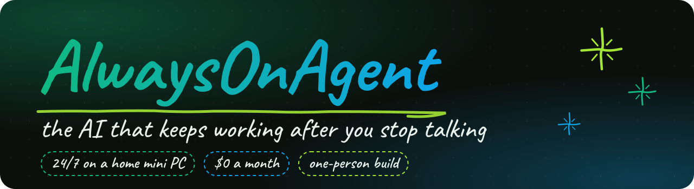
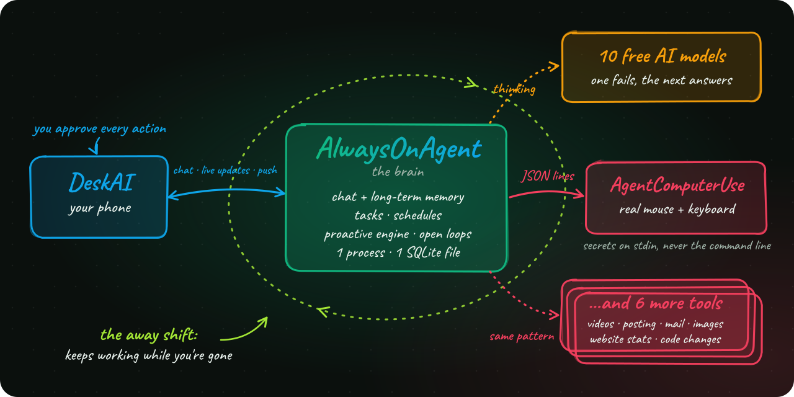

<!-- AlwaysOnAgent -->

<p align="center"></p>

<p align="center">    </p>

A personal AI agent that runs 24/7 on a home mini PC, for **$0 a month**. It doesn't only answer. It follows up on what you're waiting for, researches while you're away, and knows when *not* to interrupt, and it never touches your accounts without your tap. Designed and built by one self-taught developer working with AI coding assistants, together with its Android app, [DeskAI](https://github.com/TheVibeCheckProject/Desk-AI-Showcase), and its computer-use hands, [AgentComputerUse](https://github.com/TheVibeCheckProject/AgentComputerUse-Showcase).


&nbsp; **Open loops.** When a memory is waiting on something (a reply, a decision, a delivery), the agent tracks it, researches it on a schedule, and settles it only when it can quote the evidence, with a second AI checking.

&nbsp; **The away shift.** After two quiet hours, background workers take over: researching the owner's interests, tidying memory, and scouting free AI credits and hackathons, all saved for later.

&nbsp; **Proactive, with manners.** Ideas go into a ranked pool with novelty and repeat checks. Non-urgent messages wait until the owner is around, every message says *why* it was sent, and reactions (👍 👎, less like this) shape what comes next.

&nbsp; **Memory that has to prove itself.** Every saved fact quotes the owner's own words, and the quote is checked. Newer facts supersede older ones, search is hybrid (local Qwen3 embeddings + SQLite full-text), and deleting a memory needs a second AI to agree.


&nbsp; **Nothing happens behind your back.** Every action on the owner's accounts is a card with the exact action that waits for a tap. Email, web and screen text reach the model labelled as untrusted, and secrets never reach a model, a log or git.

&nbsp; **Measured, not guessed.** Evaluation scripts decide what ships: sycophancy, prompt injection (attacks planted in emails and web pages; a case fails if any action tool fires), and blind comparisons of model answers. The test suite can never call a real model.

&nbsp; **Never down for lack of a model.** A router walks 10 free LLM routes across 4 providers (Google's Gemini and Gemma, Groq, Cloudflare, Mistral) with pacing, cooldowns and size caps.

&nbsp; **Deploys that undo themselves.** One script pulls on the server, runs the full test suite *there*, restarts, health-checks, and rolls back to the previous commit if anything looks wrong.


| **~43k**<br><sub>lines of Python</sub> | **688**<br><sub>tests</sub> | **10**<br><sub>LLM routes, $0/month</sub> | **1 process**<br><sub>4 threads, 1 SQLite file</sub> |
|:---:|:---:|:---:|:---:|


One Python process on the mini PC runs four threads around one SQLite database. Anything slow or specialised runs as a **separate tool program in its own repo**: the agent starts it, streams its progress as JSON lines, and hands it secrets on stdin, never on the command line. New abilities arrive as new tools, not as a bigger brain.

<p align="center"></p>

| Public showcase | What it does |
|---|---|
| [**AgentComputerUse**](https://github.com/TheVibeCheckProject/AgentComputerUse-Showcase) | The hands: uses a real Windows desktop with the real mouse and keyboard, and proves a task is done |
| [**DeskAI**](https://github.com/TheVibeCheckProject/Desk-AI-Showcase) | The face: the Android app to chat, watch tasks live, approve actions and take over the PC |


<sub>TiktokVideos (narrated 3D videos, posted to TikTok) · SocialPostEngine (Pinterest) · Connectors (Gmail, Calendar, Drive and more, sending only after approval) · ImageGen · VibeStats (website numbers) · AgentWork (code changes on a branch). Same pattern, private repos.</sub>


| Start here | What you'll find |
|---|---|
| [`core/open_loops.py`](core/open_loops.py) | Open loops: what the owner is waiting on, researched on a cadence, settled only with a verified quote |
| [`core/away_shift.py`](core/away_shift.py) | The away shift: background research and memory upkeep while the owner is gone |
| [`core/proactive.py`](core/proactive.py), [`core/candidates.py`](core/candidates.py) | Proactive messages: the ranked candidate pool, novelty checks, presence-aware timing |
| [`core/memory.py`](core/memory.py), [`core/embedder.py`](core/embedder.py) | Long-term memory: quote-checked facts, supersession, hybrid search |
| [`core/llm.py`](core/llm.py) | The model router: 10 routes, pacing, cooldowns, failover |
| [`core/assistant_tools.py`](core/assistant_tools.py) | The chat's tools and the router that picks which ones each message gets |
| [`scripts/deploy_mini.py`](scripts/deploy_mini.py) | The deploy that tests on the server and rolls itself back |
| [`scripts/eval_injection.py`](scripts/eval_injection.py), [`scripts/eval_sycophancy.py`](scripts/eval_sycophancy.py) | Evaluations: prompt injection and sycophancy, on real conversations |
| [`tests/conftest.py`](tests/conftest.py) | The guard that makes it impossible for a test to call a real model |


Much of this code was written by AI coding assistants working under my direction, across many separate sessions. What keeps that coherent is the playbook every AI reads before touching anything, [`docs/AI_HANDOFF.md`](docs/AI_HANDOFF.md):

&nbsp; **One source of truth.** The code wins over any doc, and a change in behaviour updates the doc in the same commit. A test checks the docs against the code.

&nbsp; **Tests before deploy.** Every bug fix comes with a test that fails without it, and the deploy reads pytest's own exit code before anything restarts.

&nbsp; **Fix causes, not symptoms.** Comments explain *why*, dated when they came from an incident, and [`docs/CHANGELOG.md`](docs/CHANGELOG.md) records what was decided and what must never be undone.

&nbsp; **Guardrails for the AIs too.** Nothing public or on the owner's accounts without the owner's tap, secrets never in a model, log or git, and free tiers only.


```powershell
pip install -r requirements.txt -r requirements-dev.txt
Copy-Item .env.example .env      # a free GEMINI_API_KEY and any HUD_AUTH_TOKEN of your choice
python supervisor.py             # API on :8080, task daemon, schedules, push watcher
python -m pytest -q -n auto      # 688 tests; none of them can reach a real model
```

Features backed by a tool program need that tool installed next to it; most tools live in private repos.

---

> **About this copy.** This is a sanitized snapshot of a self-hosted, single-user personal agent that runs on a home mini PC on free tiers only. It is not the live private repo: history is not included. The owner is called "Alex" here, and names, places, accounts and network details are placeholders. Licensed MIT.
