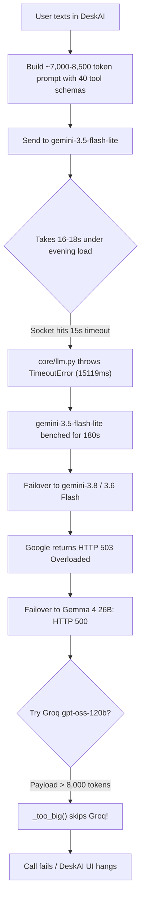
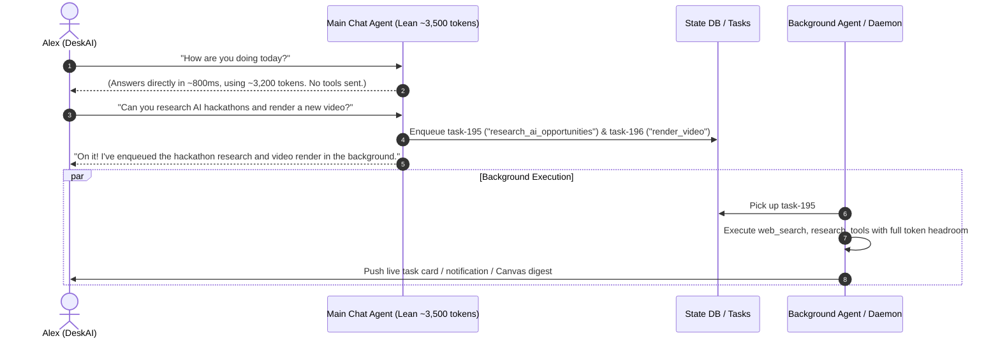

# Architectural Plan: Decoupling Chat Agent & Achieving ~3,500 Tokens/Message

## 1. Executive Summary

This plan details the forensic token usage of the live AlwaysOnAgent chat system, identifies the root causes of recent LLM failures, and provides an architectural blueprint to **separate tool execution to a background agent** and **cap main chat prompt usage at ~3,500 tokens per message**.

> [!IMPORTANT]
> **No code changes have been made yet.** This document provides the research findings, data evidence from production, and a proposed step-by-step implementation plan for your review and approval.

---

## 2. Forensic Research: What is Getting Used & Why

Across 63 chat calls in the last 24 hours on Alex's Mini (`agent-mini`), the system consumed **343,030 prompt tokens** (averaging **5,445 tokens** per turn, peaking at **8,193 tokens**). 

### Live Token Breakdown per Chat Turn (from Production Row #1898 / #1861)

```
┌───────────────────────────────────────────────────────────────────────────────┐
│ Current Average Prompt: ~5,500 – 8,200 Tokens                                 │
├──────────────────────────┬──────────────┬────────┬────────────────────────────┤
│ Component                │ Tokens       │ %      │ Root Cause of Bloat        │
├──────────────────────────┼──────────────┼────────┼────────────────────────────┤
│ Persona (ASSISTANT_PERSONA)│ ~3,200 tokens│ ~45%   │ 88 lines describing all    │
│                          │              │        │ 41 tools in verbose prose  │
├──────────────────────────┼──────────────┼────────┼────────────────────────────┤
│ Tool JSON Schemas (specs)│ 1,760 – 3,825│ ~35%   │ 11 Core tools hardcoded +  │
│                          │ tokens       │        │ matched groups sent every  │
│                          │              │        │ turn, even on greetings    │
├──────────────────────────┼──────────────┼────────┼────────────────────────────┤
│ Conversation History     │ 1,200 – 1,850│ ~15%   │ Budgeted up to 3,200 tokens│
├──────────────────────────┼──────────────┼────────┼────────────────────────────┤
│ Summaries & Archive      │ 1,100 – 1,300│ ~10%   │ Budgeted 900 + 400 tokens  │
├──────────────────────────┼──────────────┼────────┼────────────────────────────┤
│ Facts & Profile          │ 450 – 600    │ ~5%    │ Budgeted 500 + 350 tokens  │
├──────────────────────────┼──────────────┼────────┼────────────────────────────┤
│ System Status & Time     │ 150 – 200    │ ~2%    │ Daemon state, task list    │
└──────────────────────────┴──────────────┴────────┴────────────────────────────┘
```

### Critical Discovery in `data/tool_routing.jsonl`
In our inspection of the production routing logs on Alex's Mini, **over 85% of chat turns had `"tools_called": []`**.
- Even for basic conversations like *"It's been a long day!"* or *"It's honestly already finished and active"*, the system sent **~1,760 to 3,825 tokens of tool schemas** and **~1,500 tokens of tool manuals** inside the persona.
- The model was forced to ingest an 8,000+ token prompt on every single turn just to say a friendly reply.

---

## 3. Why LLM Calls Are Failing

The massive prompt size creates a cascade of three fatal issues:



1. **15-Second Client Socket Timeout ([core/llm.py:666](file:///c:/Projects/AlwaysOnAgent/core/llm.py#L666)):**
   `chat_with_tools` hardcodes `timeout: int = 15`. Ingesting 8,000+ tokens and ~20 tool schemas takes 16–18 seconds on Google's free tier during peak hours. Python terminates the connection at 15.1 seconds.
2. **180-Second Bench Penalty:**
   Timing out triggers `TIMEOUT_COOLDOWN = 180.0`, locking out `gemini-3.5-flash-lite` for 3 minutes.
3. **Failover Overload Cascade:**
   The fallback models (`gemini-3.8-flash`, `gemini-3.6-flash`, `gemma-4-26b`) are intermittently returning HTTP 503 (Overloaded) and HTTP 500 during evening peaks.
4. **Groq Lockout ([core/llm.py:381](file:///c:/Projects/AlwaysOnAgent/core/llm.py#L381)):**
   Groq is hardcoded with `REQUEST_TOKEN_CAPS = (("groq:", 8000),)`. Total request tokens (`prompt + tools + max_tokens`) exceeds 8,000 tokens, so `_too_big()` automatically drops Groq. Groq is completely disabled as a fallback!

---

## 4. The Proposed Architecture: Main Chat Agent vs. Background Agent

To honor your design:
- **Main Chat Agent:** Pure conversation, minimal tokens (~3,500 total), fast (<1s latency), warm companion.
- **Background Agent:** Handles heavy computing, lookups, multi-round tool execution, web research, coding, and file actions.



### How Tools are Separated:

| Category | Currently (Bloated) | Proposed Separation |
|---|---|---|
| **Heavy Actions** (`render_video`, `post_video_to_tiktok`, `post_pins`, `make_pins`, `start_project_job`, `research_ai_opportunities`, `computer_task`) | Declared inline in every chat turn | **Background Tasks only.** Chat agent simply enqueues them via `/task` or `propose_task`. |
| **Heavy Lookups** (`web_research`, `fetch_webpage`, `read_logs`, `list_project_files`, `read_project_file`, `preview_task_diff`, `drive_search`, `gmail_read`) | Declared inline in every chat turn | **Background Tasks or Away Shift.** Chat agent inspects live status or triggers a background lookup if needed. |
| **Chat Interaction Tools** (`ask_user`, `propose_task`) | Buried in 41 tools | **Retained as minimal companion tools (~150 tokens)**, or dispatched via structured cards. |

---

## 5. Token Reallocation: Achieving the ~3,500 Token Target

By separating background tools from the main chat agent, we can reallocate budgets to reliably hit **~3,200 – 3,500 tokens**:

| Component | Current Usage | Proposed Budget | Method of Reduction |
| :--- | :--- | :--- | :--- |
| **Persona** | ~3,200 tokens | **~600 tokens** | Remove 1,500 tokens of tool manuals. Keep core identity, texting style, memory rules, and delegating work to background tasks. |
| **Tool Schemas (`specs`)** | 1,760 – 3,825 tokens | **0 – 150 tokens** | 39 tools removed from chat turns. Only 0–2 minimal dispatch tools (`propose_task`, `ask_user`) kept if needed. |
| **Conversation History** | 1,200 – 1,850 tokens | **1,400 tokens** | Fit the last 8–10 verbatim messages cleanly. |
| **Summaries (Compressed)** | 800 – 920 tokens | **450 tokens** | Lower `BUDGET["summaries"]` from 900 to 450 tokens. |
| **Facts & Profile** | 450 – 600 tokens | **400 tokens** | Keep top 5 relevant facts (250 tokens) + profile brief (150 tokens). |
| **Archive Search** | 200 – 350 tokens | **150 tokens** | Keep top 2 semantic archive hits instead of 4. |
| **System Status & Time** | 150 – 200 tokens | **150 tokens** | Concise status line (daemon status, active task, date/time). |
| **TOTAL CHAT PROMPT** | **5,500 – 8,200 tokens** | **~3,150 – 3,300 tokens** | **Target achieved with 200–350 token buffer!** |

---

## 6. Key System Benefits

1. **Elimination of Timeouts:**
   A ~3,200 token prompt with no tool schemas will execute in **~800ms to 1.5s** on Gemini Flash-Lite. The 15s timeout will never be breached.
2. **Groq Failover Unlocked:**
   Total payload (`3,300 prompt + 900 completion = 4,200 tokens`) is well under the 8,000 token limit. Groq (`gpt-oss-120b`) will immediately catch any Google service outages with zero dropped chats.
3. **2x–3x Free Quota Savings:**
   Cutting prompt tokens by more than half prevents hitting daily or per-minute token limits.
4. **Preserved Background Power:**
   Background tasks and workers continue to have full access to all 41 tools, web search, FFmpeg, and coding engines without affecting chat performance.

---

## 7. Implementation Plan (Phases)

### Phase 1: Chat Persona & Memory Budget Compacting
- [ ] Create a lean `CHAT_PERSONA` (~600 tokens) in [core/memory.py](file:///c:/Projects/AlwaysOnAgent/core/memory.py) focused on companionship and background delegation, while preserving full capability text in `BACKGROUND_PERSONA` for task engines.
- [ ] Adjust `BUDGET` dictionary in [core/memory.py](file:///c:/Projects/AlwaysOnAgent/core/memory.py) (`summaries: 450`, `facts: 250`, `profile: 150`, `archive: 150`, `history: 1400`).

### Phase 2: Tool Separation for Chat
- [ ] Update [core/assistant_tools.py](file:///c:/Projects/AlwaysOnAgent/core/assistant_tools.py) to offer `chat_specs()` containing only companion dispatch (`propose_task`, `ask_user`), moving heavy lookups/actions to background task execution.
- [ ] Ensure [interfaces/hud/chat.py](file:///c:/Projects/AlwaysOnAgent/interfaces/hud/chat.py) passes lean specs for interactive chat.

### Phase 3: Safety & Failover Tuning
- [ ] Adjust default chat timeout in [core/llm.py](file:///c:/Projects/AlwaysOnAgent/core/llm.py) from 15s to 25s as a safety buffer for peak internet latency.
- [ ] Verify that Groq takes over chat seamlessly when Gemini routes are simulated offline.

### Phase 4: Verification & Deployment
- [ ] Run full test suite (`pytest tests -q -p no:cacheprovider`) to ensure all 542 unit tests pass.
- [ ] Deploy to Alex's Mini (`agent-mini`) and verify live token metrics on real chat messages.

---

## 8. Alternative Option: Background Tool Router

### The idea (Alex's original mental model)

Alex's understanding was that tool calls already went through a background model: a small, cheap model would look at each chat turn, decide which tools the turn needed, and inform the chat agent — so the chat model itself never had to carry all 41 schemas. That design was never built. Background models do exist, but they serve background workers (memory consolidation, proactive scoring, open-loop checks) — not chat tool routing. In chat today, the model gets every schema inline and picks tools itself, which is the bloat §2 measured. This section describes Alex's imagined design as a real alternative to the full separation in §4.

### How it would work

1. Each chat turn first goes to a lightweight router model (Flash-Lite class): the user message + recent context + the list of tool *groups* (names plus one-line descriptions, ~300–500 tokens) — not full schemas.
2. The router returns which groups are relevant (usually 0–2) as a small JSON list. No tools needed → the chat turn runs with zero schemas, as lean as §5's target.
3. The chat model then receives only the schemas for the matched groups inline and can call tools *instantly in the same turn* — no enqueue-and-wait.

### Token sketch per turn

| Component | Tokens |
| :--- | :--- |
| Router call (message + group list in, JSON list out) | ~400–600 in, ~50 out |
| Chat prompt (persona + history + matched schemas only) | ~3,300 + 0–800 matched |
| Typical total | ~3,700–4,700; ~3,300 when no tools needed |

### Trade-offs vs full separation (§4)

| | Full separation (§4) | Tool router (this option) |
| :--- | :--- | :--- |
| Chat prompt size | ~3,300, zero schemas | ~3,300–4,100, matched schemas only |
| Instant tool use in chat | No — heavy work becomes a background task | Yes — lookups and light actions stay instant |
| Extra model call per turn | None | One small router call (~500 tokens, sub-second on Flash-Lite) |
| Failure modes | Chat can't do anything itself; "on it, I'll get back to you" for everything | Router mis-routes → chat lacks the tool it needs (mitigation: router may include a spare group; chat can request a re-route) |
| Size of architectural change | Large (persona split, tool removal, task-queue UX) | Medium (add a router pre-step; tools stay callable in chat) |
| Groq failover | Unlocked (payload < 8k) | Unlocked in the common case (payload < 8k) |

### When this option wins

If instant answers to light lookups ("what's on my schedule", "read that email") matter more than squeezing every last token — i.e., if §4's "everything becomes a background task" feels like a lobotomy. The router preserves the current UX (tools work in chat, instantly) while removing ~80–90% of the schema bloat: the 85% of no-tool turns from §2 would carry zero schemas, and tool turns would carry only the groups they need.

### Recommendation

Either option fixes the outage cascade in §3. The router is the smaller change with better UX preservation; full separation is the cleaner architecture with the lower token floor. If unsure, prototype the router first — it is additive (a pre-step before prompt building) and does not require the persona split, so §4 remains available as a follow-up either way.
